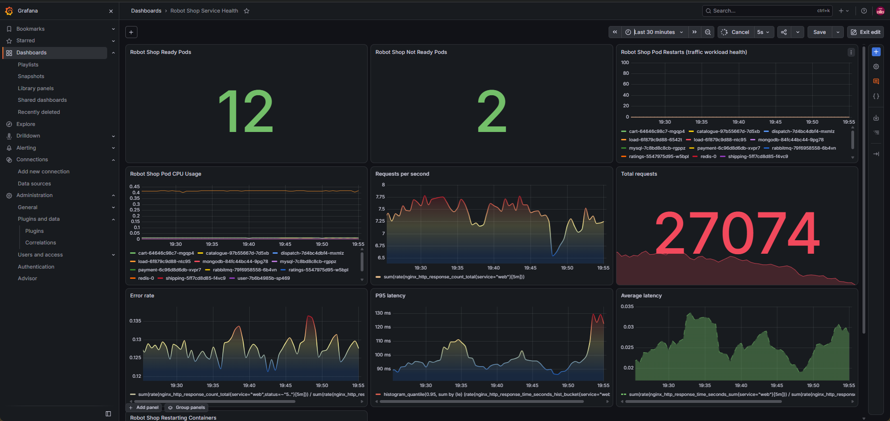

# Capstone 2 — Stan’s Robot Shop Observability

This project deploys Stan’s Robot Shop microservices application to an AWS EKS Kubernetes cluster, generates continuous application traffic, and adds an observability layer using Prometheus, Grafana, and a custom Nginx log exporter. The work focuses on collecting and visualizing the three core service-health signals: **requests, errors, and latency**.

## Project overview

Robot Shop is a microservices demo application consisting of a web gateway and several backend services, including `cart`, `catalogue`, `user`, `shipping`, `payment`, and `ratings`, along with MongoDB, Redis, MySQL, and RabbitMQ data stores. The application is deployed through the repository’s Helm chart into the `robot-shop` namespace.

The monitoring stack is deployed separately in the `monitoring` namespace using kube-prometheus-stack. It provides Prometheus for metrics collection and storage, Grafana for dashboards, and Prometheus Operator components for Kubernetes-native scrape configuration.

### Current status

| Area | Status |
|---|---|
| Robot Shop deployment | Deployed in `robot-shop` namespace |
| Web gateway | Running with Nginx log exporter sidecar |
| Nginx access-log format | Customized to include request time |
| Prometheus scraping | Working for the web exporter |
| Grafana dashboard | Robot Shop Service Health dashboard created |
| Core metrics | Requests, errors, and latency collected |
| Shipping service | Under investigation for readiness failures |

## Architecture

```text
Browser / load generator
        |
        v
AWS Load Balancer
        |
        v
web Service (port 8080)
        |
        v
web Pod
├── web container
│   ├── Nginx on port 8080
│   ├── access logs written to shared emptyDir volume
│   └── custom Nginx configuration mounted from ConfigMap
└── nginx-log-exporter container
    ├── reads /var/log/nginx/access.log
    ├── parses request latency using rt=$request_time
    └── exposes Prometheus metrics on port 4040
```

Prometheus discovers the exporter through a `ServiceMonitor`. The ServiceMonitor selects the `web` Service by its `service: web` label and scrapes the named `metrics` port at `/metrics` every 15 seconds.

## Repository layout

```text
.
├── K8s/
│   └── helm/
│       ├── templates/
│       │   ├── web-deployment.yaml
│       │   ├── web-service.yaml
│       │   ├── web-nginx-config-configmap.yaml
│       │   ├── web-nginx-log-exporter-configmap.yaml
│       │   └── web-servicemonitor.yaml
│       └── web-nginx.conf
├── monitoring/
│   └── dashboards/
│       └── robot-shop-service-health.json
└── README.md
```

## Prerequisites

The following tools are required:

- AWS CLI
- Terraform
- kubectl
- Helm 3
- Git
- A running AWS EKS cluster
- kube-prometheus-stack installed in the `monitoring` namespace

Verify cluster access before deploying:

```bash
kubectl config current-context
kubectl get nodes -o wide
kubectl get pods -A
helm list -A
```

## Deploy Robot Shop

Create the application namespace:

```bash
kubectl create namespace robot-shop
```

Deploy the application using the repository Helm chart:

```bash
helm upgrade --install robot-shop K8s/helm \
  --namespace robot-shop
```

Verify the deployment:

```bash
kubectl get pods -n robot-shop
kubectl get svc -n robot-shop
helm list -n robot-shop
```

The `web` Service is exposed as a `LoadBalancer`. Retrieve its external endpoint:

```bash
kubectl get svc web -n robot-shop
```

## Web gateway instrumentation

The stock `robotshop/rs-web` image did not include the custom Nginx access-log format required by the exporter. Rather than rebuilding and publishing a custom image, the project mounts a fully rendered Nginx configuration file from a Kubernetes ConfigMap.

### Nginx configuration

The custom Nginx configuration defines this access-log format:

```nginx
log_format upstream_time '$remote_addr - $remote_user [$time_local] "$request" '
                         '$status $body_bytes_sent "$http_referer" '
                         '"$http_user_agent" "$http_x_forwarded_for" '
                         'rt=$request_time';
```

It also configures Nginx to write access logs using that format:

```nginx
access_log /var/log/nginx/access.log upstream_time;
```

The `rt=$request_time` field is essential because the log exporter uses it to calculate request latency.

### Configuration delivery

The configuration is stored in the Helm chart as:

```text
K8s/helm/web-nginx.conf
```

It is packaged into a ConfigMap by:

```text
K8s/helm/templates/web-nginx-config-configmap.yaml
```

The web container mounts it directly as:

```text
/etc/nginx/conf.d/default.conf
```

The relevant Deployment mount is:

```yaml
volumeMounts:
- name: nginx-config
  mountPath: /etc/nginx/conf.d/default.conf
  subPath: default.conf
  readOnly: true
```

Using `subPath` replaces only the `default.conf` file rather than replacing the entire `/etc/nginx/conf.d` directory.

### Backend service names

The original Robot Shop template used environment variables such as:

```nginx
proxy_pass http://${CATALOGUE_HOST}:8080/;
```

Because the web Deployment did not define those variables, they were replaced with Kubernetes Service DNS names:

```nginx
proxy_pass http://catalogue:8080/;
proxy_pass http://user:8080/;
proxy_pass http://cart:8080/;
proxy_pass http://shipping:8080/;
proxy_pass http://payment:8080/;
proxy_pass http://ratings:80/;
```

Kubernetes resolves these short names within the same namespace.

## Nginx log exporter

A sidecar container runs `prometheus-nginxlog-exporter` alongside the web container. Both containers share the same `emptyDir` volume mounted at:

```text
/var/log/nginx
```

The exporter reads:

```text
/var/log/nginx/access.log
```

and exposes Prometheus metrics at:

```text
http://127.0.0.1:4040/metrics
```

Its exporter configuration is stored in:

```text
K8s/helm/templates/web-nginx-log-exporter-configmap.yaml
```

The exporter expects this log format:

```text
$remote_addr - $remote_user [$time_local] "$request" $status $body_bytes_sent "$http_referer" "$http_user_agent" "$http_x_forwarded_for" rt=$request_time
```

The exporter and Nginx formats must match exactly. If they do not, the exporter increments `nginx_parse_errors_total` and does not emit request or latency metrics.

## Prometheus integration

### Service port

The `web` Service includes two named ports:

```yaml
ports:
- name: http
  port: 8080
  targetPort: 8080
- name: metrics
  port: 4040
  targetPort: 4040
```

The `metrics` port routes Prometheus traffic to the exporter sidecar.

### ServiceMonitor

The ServiceMonitor is defined in:

```text
K8s/helm/templates/web-servicemonitor.yaml
```

```yaml
apiVersion: monitoring.coreos.com/v1
kind: ServiceMonitor
metadata:
  name: web-nginx-log-exporter
  labels:
    service: web
    release: monitoring
spec:
  namespaceSelector:
    matchNames:
    - robot-shop
  selector:
    matchLabels:
      service: web
  endpoints:
  - port: metrics
    path: /metrics
    interval: 15s
```

The `release: monitoring` label allows the Prometheus Operator installed by kube-prometheus-stack to discover this ServiceMonitor.

### Verification

Check that the ServiceMonitor exists:

```bash
kubectl get servicemonitor -n robot-shop
```

Check that Prometheus can reach the exporter:

```promql
up{service="web"}
```

Expected result:

```text
up{...} 1
```

Check that request metrics are present:

```promql
nginx_http_response_count_total{service="web"}
```

## Collected metrics

The exporter provides the following core metrics.

| Metric | Meaning |
|---|---|
| `nginx_http_response_count_total` | Total number of processed HTTP requests |
| `nginx_http_response_size_bytes` | Total response bytes transferred |
| `nginx_http_response_time_seconds` | Request latency summary |
| `nginx_http_response_time_seconds_hist_bucket` | Latency histogram buckets |
| `nginx_http_response_time_seconds_hist_sum` | Total observed latency |
| `nginx_http_response_time_seconds_hist_count` | Number of latency observations |
| `nginx_parse_errors_total` | Number of access-log lines the exporter could not parse |

The metrics include labels such as:

```text
app="robot-shop"
service="web"
method="GET"
status="200"
```

The `status` label enables error-rate queries for `4xx` and `5xx` responses.

## Grafana dashboard

The Grafana dashboard is named:

```text
Robot Shop Service Health
```

It uses the Prometheus data source and a one-hour default time range. The dashboard is exported as JSON to:

```text
monitoring/dashboards/robot-shop-service-health.json
```



### Core panels

| Panel | PromQL | Visualization | Unit |
|---|---|---|---|
| Requests per second | `sum(rate(nginx_http_response_count_total{service="web"}[5m]))` | Time series | `reqps` |
| Total requests | `sum(increase(nginx_http_response_count_total{service="web"}[1h]))` | Stat | `short` |
| Error rate | `sum(rate(nginx_http_response_count_total{service="web",status=~"5.."}[5m])) / sum(rate(nginx_http_response_count_total{service="web"}[5m]))` | Time series | `percentunit` |
| 5xx errors per second | `sum(rate(nginx_http_response_count_total{service="web",status=~"5.."}[5m]))` | Time series | `reqps` |
| P95 latency | `histogram_quantile(0.95, sum by (le) (rate(nginx_http_response_time_seconds_hist_bucket{service="web"}[5m])))` | Time series | `seconds` |
| Average latency | `sum(rate(nginx_http_response_time_seconds_sum{service="web"}[5m])) / sum(rate(nginx_http_response_time_seconds_count{service="web"}[5m]))` | Time series | `seconds` |

### Supporting panels

| Panel | PromQL | Visualization | Purpose |
|---|---|---|---|
| Requests by status | `sum by (status) (rate(nginx_http_response_count_total{service="web"}[5m]))` | Time series | Shows 2xx, 4xx, and 5xx traffic |
| Requests by method | `sum by (method) (rate(nginx_http_response_count_total{service="web"}[5m]))` | Time series | Shows GET, POST, and PUT traffic |
| Robot Shop Ready Pods | `sum(kube_pod_status_ready{namespace="robot-shop",condition="true"})` | Stat | Current ready Pod count |
| Robot Shop Not Ready Pods | `sum(kube_pod_status_ready{namespace="robot-shop",condition="false"})` | Stat | Current unready Pod count |
| Pod restarts, 1h | `sum by (pod) (increase(kube_pod_container_status_restarts_total{namespace="robot-shop"}[1h]))` | Time series | Detects crashing workloads |

## Accessing Grafana and Prometheus

For local browser access, use Kubernetes port-forwarding. This creates a temporary local tunnel and avoids exposing monitoring tools publicly.

List monitoring Services:

```bash
kubectl get svc -n monitoring
```

Forward Grafana:

```bash
kubectl port-forward -n monitoring svc/monitoring-grafana 3000:80
```

Open:

```text
http://localhost:3000
```

Forward Prometheus in a second terminal:

```bash
kubectl port-forward -n monitoring \
  svc/monitoring-kube-prometheus-prometheus 9090:9090
```

Open:

```text
http://localhost:9090
```

Stop either tunnel with `Ctrl+C`.

## Load generation

A Robot Shop load generator runs in the `robot-shop` namespace and continuously exercises the application through the web gateway. This produces realistic request, error, and latency data for the dashboard.

Check the load generator:

```bash
kubectl get pods -n robot-shop -l service=load
kubectl logs -n robot-shop -l service=load --tail=50
```

## Troubleshooting performed

### Missing Deployment header

An early Helm upgrade failed because `web-deployment.yaml` began at `spec:` and omitted its top-level object header:

```yaml
apiVersion: apps/v1
kind: Deployment
metadata:
  name: web
```

Helm reported:

```text
Object 'Kind' is missing
```

The fix was to restore the complete Deployment header before the `spec` block.

### Exporter parse errors

After the exporter was deployed, it exposed only:

```text
nginx_parse_errors_total
```

Investigation showed that the running Nginx image was still using its original access-log format, which did not include `rt=$request_time`. The exporter could not parse the log lines.

The fix was to mount a complete custom Nginx configuration from a ConfigMap directly at:

```text
/etc/nginx/conf.d/default.conf
```

### ServiceMonitor target missing

Prometheus initially returned no `nginx_*` metrics even though the exporter was healthy inside the Pod.

The cause was that the ServiceMonitor referenced:

```yaml
port: metrics
```

but the `web` Service did not define a named `metrics` port. Prometheus could not create a scrape target.

The fix was to add:

```yaml
- name: metrics
  port: 4040
  targetPort: 4040
```

to the `web` Service.

### Grafana empty panels

Grafana panels initially returned no data because the exporter metrics do not include a `namespace="robot-shop"` label. Queries using that label returned empty results.

The corrected queries use only labels actually present on the exporter metrics, such as:

```promql
service="web"
```

## Shipping incident

During dashboard validation, the Shipping Pod remained `Running` but became unready. Kubernetes repeatedly reported:

```text
Readiness probe failed:
Get "http://172.31.40.61:8080/health":
context deadline exceeded
```

### Evidence

Shipping logs showed repeated MySQL-related errors and HikariCP connection-pool warnings:

```text
Failed to validate connection ...
No operations allowed after connection closed.
```

A health check from inside the Shipping container also timed out:

```bash
kubectl exec -n robot-shop shipping-5ff7cd8d85-f4vc9 -- \
  sh -c 'wget -S -O - http://127.0.0.1:8080/health'
```

This indicates that the application was saturated or blocked on MySQL, preventing it from serving even its own health endpoint.

### Initial assessment

Shipping was not crash-looping. It was a **Running but Not Ready** workload. The readiness probe failed because the application could not respond within the configured timeout.

### Immediate mitigation

Restart the Shipping Deployment to replace the saturated Pod:

```bash
kubectl rollout restart deployment shipping -n robot-shop
kubectl rollout status deployment shipping -n robot-shop
```

### Follow-up investigation

If the issue recurs, investigate:

- Shipping CPU and memory limits
- MySQL connection limits and connection lifetime
- HikariCP pool configuration
- Load-generator traffic volume
- Shipping readiness-probe timeout and failure threshold
- MySQL Pod resource pressure

## Next steps

- Complete the Shipping incident investigation and postmortem.
- Add alerts for elevated 5xx error rate, high P95 latency, and unready Pods.
- Add structured logging and log-based observability.
- Add distributed tracing for at least one end-to-end request.
- Define an SLO for web-gateway availability and latency.
- Run an incident drill that triggers an alert and follows a documented runbook.
- Optionally add burn-rate alerts and chaos testing.

## Commands reference

Render the Helm chart:

```bash
helm template robot-shop K8s/helm \
  --namespace robot-shop \
  --debug > /tmp/robot-shop-rendered.yaml
```

Dry-run an upgrade:

```bash
helm upgrade robot-shop K8s/helm \
  --namespace robot-shop \
  --dry-run=client \
  --debug
```

Apply an upgrade:

```bash
helm upgrade robot-shop K8s/helm \
  --namespace robot-shop \
  --debug
```

Check web Pod status:

```bash
kubectl get pods -n robot-shop -l service=web
```

Check exporter logs:

```bash
kubectl logs -n robot-shop deployment/web \
  -c nginx-log-exporter --tail=50
```

Check exporter metrics:

```bash
kubectl exec -n robot-shop deploy/web -c web -- \
  curl -s http://127.0.0.1:4040/metrics | head -100
```

Check Shipping logs:

```bash
kubectl logs -n robot-shop -l service=shipping --tail=100
```

Check recent namespace events:

```bash
kubectl get events -n robot-shop --sort-by=.lastTimestamp | tail -30
```